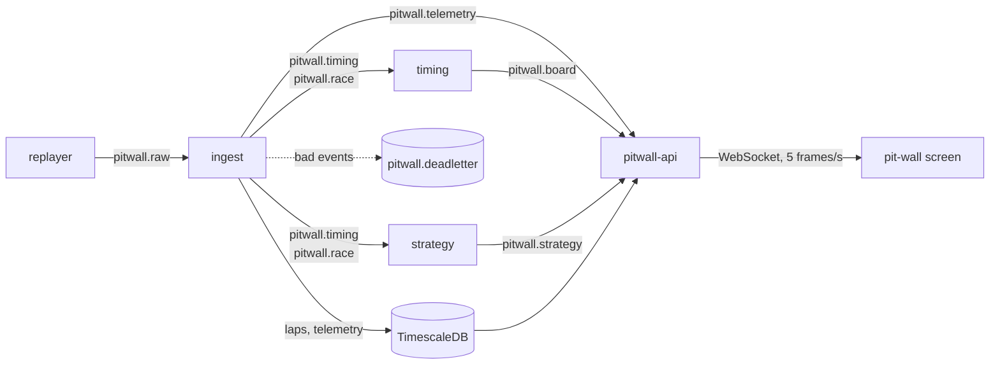

# Pitwall

**Real race telemetry, streamed like it's live, on a platform that keeps itself healthy.**

Pitwall replays real Grands Prix (car telemetry, positions, lap times, tyres, pit stops, race
control and weather) as a live event stream through Redpanda, into services on Kubernetes that
rebuild a live pit wall from it: a timing tower, the circuit with every car on it, one car's
telemetry, tyre strategy and race control. Argo CD deploys it all from this repository. Next it
grows the reliability engineering: SLOs, self-healing canary deploys, a trackside site with a link
you can cut, and chaos GameDays. See [the plan](docs/plan.md).

> Unofficial personal project. Not associated with Formula 1, the FIA or any team. Race data
> comes from [OpenF1](https://openf1.org), a free, unofficial API.

## Status

| Phase | |
|---|---|
| 0. Foundations and data: race download, replayer, event format, CI | ✅ |
| 1. Pipeline on one cluster: Redpanda, services, pit-wall screen, Argo CD | ✅ |
| 2. Observability and SLOs | next |
| 3. Self-healing deploys (Argo Rollouts canaries) | |
| 4. Trackside and factory, with a link you can cut | |
| 5. Race weekend at scale: autoscaling, load tests, chaos GameDays | |
| 6. Polish, demo video, public demo | |

## How it fits together



- **replayer** plays a race into Redpanda at any speed, and can change speed mid-race. A replay
  that starts mid-race first sends a catch-up (grid, stints, earlier stops and flags), so every
  service has the race so far.
- **ingest** checks every event against the [schema](docs/events.md), routes it by type (keyed
  by car, so each car's events stay in order) and records laps and telemetry in TimescaleDB. An
  event that breaks the contract goes to a dead-letter topic; the race carries on.
- **timing** and **strategy** fold the stream into the timing board and the tyre model. They
  never store state: on start-up they rebuild it from the topic log, so a restarted pod catches
  up by itself.
- **pitwall-api** pushes everything to browsers over a WebSocket and serves the screen.
- Each replay is a **run** with its own time-ordered id in a message header, so a new replay
  resets every service, and a late message from an old run can never take over again.

Details in [docs/architecture.md](docs/architecture.md).

## Run it

You need Docker (8 GB of memory for it is plenty), [kind](https://kind.sigs.k8s.io),
`kubectl` and Helm, and Python 3.12+ for the CLI.

```bash
pip install -e .
pitwall fetch 2024-sao-paulo       # download a race once (about 6 minutes)
./scripts/cluster-up.sh            # kind, Traefik, Argo CD; Argo CD deploys the rest
```

Then open **http://localhost:8080** (or http://pitwall.localtest.me:8080). The replayer starts
São Paulo 2024 at real speed and loops it; the bar at the top picks a race, a starting lap and a
speed. Argo CD is at http://argocd.pitwall.localtest.me:8080.

The cluster mounts `~/.pitwall` from your machine, so a race downloaded once is there for both
the CLI and the cluster (the replayer downloads one itself if it's missing).

## Try the replayer on its own

```bash
pitwall races 2024                 # the year's races
pitwall replay 2024-sao-paulo --speed 10
```

```text
-0:51:55.5  RACE  São Paulo Grand Prix · Interlagos · 20 drivers · 69 laps
 0:19:57.5  RC         SESSION STARTED
 0:19:57.5  TYRE  VER  stint 1  INTERMEDIATE (new) from lap 1
 0:19:58.0  RC          GREEN  GREEN LIGHT - PIT EXIT OPEN
 ...
 0:54:31.9  PIT   LEC  lap 24  2.6 s stopped, 24.6 s in the pit lane
 1:02:01.0  LAP   VER  lap 29   1:45.014   S1 25.007  S2 55.169  S3 24.838
 1:07:22.0  RC          RED  RED FLAG
```

Times count from the scheduled start; rain delayed this one by 20 minutes. The whole race is
1.86 million events (a 21 MB file); `--speed 0` replays all of it in about 20 seconds.

| | |
|---|---|
| `--speed 10` | Ten times real time; `0` sends everything as fast as possible |
| `--from-lap 30` | Start at lap 30; `0` includes the build-up before the start |
| `--types lap,pit,race.control` | Only these event types (prefixes work: `car` = telemetry and positions) |
| `--cars 1,4` | Only these cars (race-wide events are kept) |
| `--format jsonl` | One JSON event per line, for piping into other tools |
| `--to kafka` | Into Redpanda's `pitwall.raw` (`PITWALL_BROKERS`, default `localhost:9092`) |

`pitwall info RACE` summarises a download and `pitwall validate RACE` checks every event
against the schema.

## Team logos

Logos are trademarks, so none are in this repository. To see them locally, put them in
`assets/private/` named after the team (`red-bull-racing.png`, `mclaren.svg`); the folder is
ignored by Git and mounted into the cluster. Without them, the pit wall shows team-colour badges.

## Layout

| Path | |
|---|---|
| `src/pitwall/` | Event format, race download, replayer, the bus, the timing and strategy models, CLI |
| `src/pitwall/services/` | The five services; each runs as `pitwall service <name>` |
| `web/` | The pit-wall screen (React, TypeScript, Vite) |
| `deploy/charts/` | Helm charts: `pitwall` (services) and `pitwall-data` (Redpanda, TimescaleDB) |
| `deploy/apps/`, `deploy/env/` | Argo CD applications and the local environment's values |
| `scripts/cluster-up.sh` | The kind cluster, Traefik and Argo CD |
| `schemas/` | Generated JSON Schema for events |
| `tests/` | Unit tests, no network or cluster needed |

## Develop

```bash
pip install -e ".[dev]"
ruff check src tests && ruff format --check src tests
pytest
cd web && npm ci && npm run dev    # the screen on :5180, against pitwall-api on :8104
```

CI lints and tests the Python and the screen, lints and renders the Helm charts, scans the
source and the image with Trivy, and on `main` pushes the image to GHCR signed with cosign. Then
it **promotes** it: it commits the new image tag to `deploy/env/local/pitwall.yaml`, and Argo CD
rolls out exactly the image CI built, scanned and signed.
