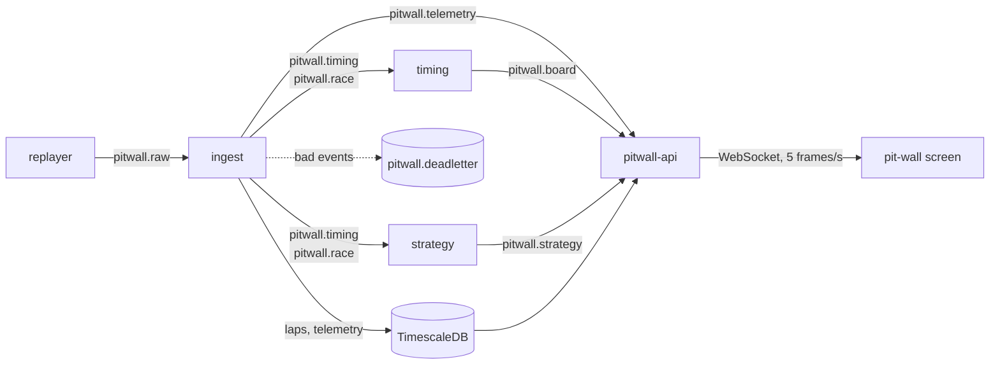

# Pitwall

**Real race telemetry, streamed like it's live, on a platform that keeps itself healthy.**

Pitwall replays real Grands Prix (car telemetry, positions, lap times, tyres, pit stops, race
control and weather) as a live event stream through Redpanda, into services on Kubernetes that
rebuild a live pit wall from it: a timing tower, the circuit with every car on it, one car's
telemetry, tyre strategy and race control. Argo CD deploys it all from this repository. Next it
grows the reliability engineering: SLOs, self-healing canary deploys, a trackside site with a link
you can cut, and chaos GameDays. See [the plan](docs/plan.md).

> Unofficial personal project. Not associated with Formula 1, the FIA or any team. Race data
> comes from [OpenF1](https://openf1.org), a free, unofficial API.

## Status

| Phase | |
|---|---|
| 0. Foundations and data: race download, replayer, event format, CI | ✅ |
| 1. Pipeline on one cluster: Redpanda, services, pit-wall screen, Argo CD | ✅ |
| 2. Observability and SLOs | ✅ |
| 3. Self-healing deploys (Argo Rollouts canaries) | ✅ |
| 4. Trackside and factory, with a link you can cut | ✅ |
| 5. Race weekend at scale: autoscaling, load tests, chaos GameDays | ✅ |
| 6. Polish, demo video, public demo | |

## How it fits together



- **replayer** plays a race into Redpanda at any speed, and can change speed mid-race. A replay
  that starts mid-race first sends a catch-up (grid, stints, earlier stops and flags), so every
  service has the race so far.
- **ingest** checks every event against the [schema](docs/events.md), routes it by type (keyed
  by car, so each car's events stay in order) and records laps and telemetry in TimescaleDB. An
  event that breaks the contract goes to a dead-letter topic; the race carries on.
- **timing** and **strategy** fold the stream into the timing board and the tyre model. They
  never store state: on start-up they rebuild it from the topic log, so a restarted pod catches
  up by itself.
- **pitwall-api** pushes everything to browsers over a WebSocket and serves the screen.
- Each replay is a **run** with its own time-ordered id in a message header, so a new replay
  resets every service, and a late message from an old run can never take over again.

Details in [docs/architecture.md](docs/architecture.md).

## Trackside and factory

The race starts at the track: the replayer streams into a trackside Redpanda, and an uplink
carries it to the factory through a link (Toxiproxy) that can be slowed, narrowed or cut. The
trackside buffers whatever the link does; every car's events are numbered, so the factory drops
re-sent duplicates and counts anything missing.

Cut for 60 seconds mid-race, the link left 10,200 events waiting at the track, the pit wall
froze and then jumped forward when it returned, the backlog drained in **1.1 s**, and **no
event was lost**. Getting honest numbers took four drill runs; three found a measurement that
lied. Details in [docs/trackside.md](docs/trackside.md).

## Race weekend at scale

KEDA scales ingest on consumer lag and the API on connected browsers. A k6 load test (200
browsers on a replay at 20×, about 3,100 events a second) holds 4.9 frames a second per browser
with a 205 ms p99 gap between frames, at about 0.35 API cores per 100 browsers.

Four Chaos Mesh GameDays, each with a hypothesis written down first: kill the broker mid-race,
crash the processors, slow the network, slow the database's disk. Three disproved their
hypothesis the first time, and the load test once caught a release that refused every browser
(and passed its canary). Each failure was a real defect, now fixed, and the canary now opens a
WebSocket like a browser. A trimmed suite runs every night in CI. The postmortems:
[docs/scale-and-chaos.md](docs/scale-and-chaos.md).

## Self-healing releases

Every release of ingest, timing, strategy and the API is a canary with Argo Rollouts: one pod
of the new version next to stable, then analysis of that pod's own metrics (freshness against
its SLO, restarts, dead letters, errors) before it is promoted. Stream services get stream
canaries: ingest's canary takes a share of the partitions; timing and strategy run full copies
side by side, and the API compares their boards car by car, so a release that is fast and
stable but *wrong* is caught too.

Three rehearsed bad releases, each shipped as a Git commit, were caught and rolled back without
anyone touching anything:

| Bad release | Caught by | In |
|---|---|---|
| A slow ingest | its p99 freshness: 4.96 s against 0.5 s | 1 min 48 s |
| A timing service with silently wrong gaps | 94% of its gaps disagreed with the stable board | 1 min 53 s |
| A strategy service that crashes | two restarts at the first check | 1 min 23 s |

Details in [docs/progressive-delivery.md](docs/progressive-delivery.md).

## Observability and SLOs

Every service exports Prometheus metrics, logs JSON to Loki and traces each sampled event through
every Kafka hop into Tempo. The replayer stamps each message with its send time, so freshness is
measured stage by stage, and the SLOs are about what the pit wall's users feel:

| SLO | Objective |
|---|---|
| Telemetry reaches the pit wall within 500 ms | 99% |
| Timing-board updates go out within 1 s of their oldest event | 99% |
| Events pass the schema | 99.9% |
| API requests succeed | 99.5% |

They are code ([`scripts/slos.py`](scripts/slos.py)) that generates the SRE workbook's
multi-window burn-rate alerts, each linked to a [runbook](docs/runbooks/README.md). Grafana's
**Pitwall · Race health** dashboard is code too. In the first drill, an injected 800 ms delay paged
within a minute and cleared on its own once removed. Details, and what running it uncovered, in
[docs/observability.md](docs/observability.md).

## Run it

You need Docker (the whole platform uses about 5 GB of memory), [kind](https://kind.sigs.k8s.io),
`kubectl` and Helm, and Python 3.12+ for the CLI.

```bash
pip install -e .
pitwall fetch 2024-sao-paulo       # download a race once (about 6 minutes)
./scripts/cluster-up.sh            # kind, Traefik, Argo CD; Argo CD deploys the rest
```

Then open **http://localhost:8080** (or http://pitwall.localtest.me:8080). The replayer starts
São Paulo 2024 at real speed and loops it. Grafana is at http://grafana.pitwall.localtest.me:8080,
Prometheus at http://prometheus.pitwall.localtest.me:8080 and Argo CD at
http://argocd.pitwall.localtest.me:8080.

## The pit wall

The screen is laid out the way a team's strategy screens are, around **one team's two cars**:
pick the team at the top (Red Bull by default) and the wall takes its colour and follows its
drivers. Team names and colours come from the race data; no team branding is used.

- **Timing screen:** position and places gained, interval or gap to the leader, last lap, sector
  times coloured purple (fastest of anyone), green (personal best) or yellow, best lap, tyre and
  age, pit stops.
- **The team's cars:** the gap to the car ahead and behind, last and best lap, tyre and its trend
  (seconds per lap, from clean laps), and the **box call**: where the car would rejoin if it
  pitted this lap, and between whom. Under a safety car the stop costs about half.
- **Race trace:** every car's gap to the leader at the end of each lap. Pit stops are the drops,
  a safety car is the field bunching up.
- **Telemetry:** both cars' speed, throttle and brake over the last 50 seconds, overlaid. Click
  any car in the timing screen to compare it with the team's lead car instead.
- **Track map, tyre strategy and race control.**

**Races** opens the race library: every season since 2023, straight from OpenF1. Downloaded
races replay at once; any other is one click to download (a few minutes, since OpenF1's free
tier allows 30 requests a minute). A new race appears about 30 minutes after its chequered flag.

**Live races.** OpenF1 serves races live only to paying sponsors (€9.90 a month, over MQTT or
WebSocket), and F1's own live timing needs an F1 TV subscription, so Pitwall works from the free
archive: a race is available half an hour after it finishes.

The cluster mounts `~/.pitwall` from your machine, so a race downloaded once is there for both
the CLI and the cluster (the replayer downloads one itself if it's missing).

## Try the replayer on its own

```bash
pitwall races 2024                 # the year's races
pitwall replay 2024-sao-paulo --speed 10
```

```text
-0:51:55.5  RACE  São Paulo Grand Prix · Interlagos · 20 drivers · 69 laps
 0:19:57.5  RC         SESSION STARTED
 0:19:57.5  TYRE  VER  stint 1  INTERMEDIATE (new) from lap 1
 0:19:58.0  RC          GREEN  GREEN LIGHT - PIT EXIT OPEN
 ...
 0:54:31.9  PIT   LEC  lap 24  2.6 s stopped, 24.6 s in the pit lane
 1:02:01.0  LAP   VER  lap 29   1:45.014   S1 25.007  S2 55.169  S3 24.838
 1:07:22.0  RC          RED  RED FLAG
```

Times count from the scheduled start; rain delayed this one by 20 minutes. The whole race is
1.86 million events (a 21 MB file); `--speed 0` replays all of it in about 20 seconds.

| | |
|---|---|
| `--speed 10` | Ten times real time; `0` sends everything as fast as possible |
| `--from-lap 30` | Start at lap 30; `0` includes the build-up before the start |
| `--types lap,pit,race.control` | Only these event types (prefixes work: `car` = telemetry and positions) |
| `--cars 1,4` | Only these cars (race-wide events are kept) |
| `--format jsonl` | One JSON event per line, for piping into other tools |
| `--to kafka` | Into Redpanda's `pitwall.raw` (`PITWALL_BROKERS`, default `localhost:9092`) |

`pitwall info RACE` summarises a download and `pitwall validate RACE` checks every event
against the schema.

## Team logos

Logos are trademarks, so none are in this repository. To see them locally, put them in
`assets/private/` named after the team (`red-bull-racing.png`, `mclaren.svg`); the folder is
ignored by Git and mounted into the cluster. Without them, the pit wall shows team-colour badges.

## Layout

| Path | |
|---|---|
| `src/pitwall/` | Event format, race download, replayer, the bus, the timing and strategy models, CLI |
| `src/pitwall/services/` | The five services; each runs as `pitwall service <name>` |
| `src/pitwall/live.py`, `history.py` | What the screen shows right now; TimescaleDB history and the race trace |
| `web/` | The pit-wall screen (React, TypeScript, Vite) |
| `deploy/charts/` | Helm charts: `pitwall` (services) and `pitwall-data` (Redpanda, TimescaleDB) |
| `deploy/apps/`, `deploy/env/` | Argo CD applications and the local environment's values |
| `deploy/charts/pitwall/templates/analysis.yaml` | What a canary must show to be promoted |
| `deploy/platform/` | Values for Argo Rollouts, KEDA and Chaos Mesh |
| `deploy/charts/pitwall-trackside/` | The trackside: its Redpanda, the replayer, the uplink, Toxiproxy |
| `deploy/observability/` | Values for Prometheus, Grafana, Loki, Tempo and the OpenTelemetry Collector |
| `deploy/charts/pitwall-observability/` | SLO rules and dashboards, generated by `scripts/slos.py` and `scripts/dashboards.py` |
| `deploy/load/`, `scripts/loadtest.sh` | The k6 load test |
| `deploy/chaos/`, `scripts/gameday.py` | GameDay experiments and the runner that judges them |
| `scripts/chaos-suite.sh` | The nightly chaos suite on a throwaway cluster |
| `scripts/cluster-up.sh` | The kind cluster, Traefik and Argo CD |
| `docs/runbooks/` | A runbook for every alert |
| `schemas/` | Generated JSON Schema for events |
| `tests/` | Unit tests, no network or cluster needed |

## Develop

```bash
pip install -e ".[dev]"
ruff check src tests && ruff format --check src tests
pytest
cd web && npm ci && npm run dev    # the screen on :5180, against pitwall-api on :8104
```

CI lints and tests the Python and the screen, lints and renders the Helm charts, scans the
source and the image with Trivy, and on `main` pushes the image to GHCR signed with cosign. Then
it **promotes** it: it commits the new image tag to `deploy/env/local/pitwall.yaml`, and Argo CD
rolls out exactly the image CI built, scanned and signed.
